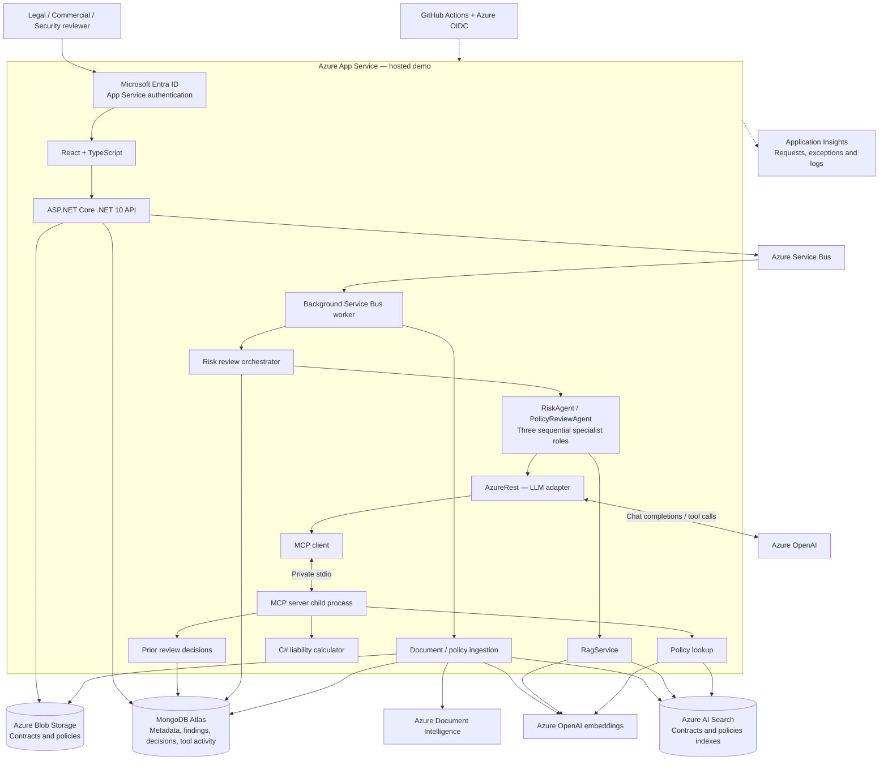
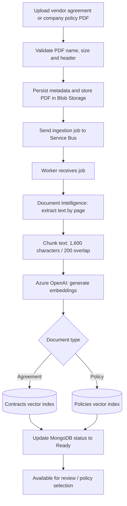
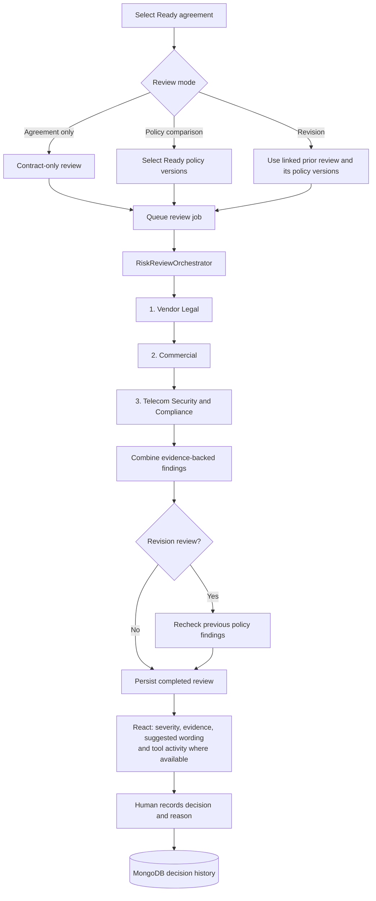
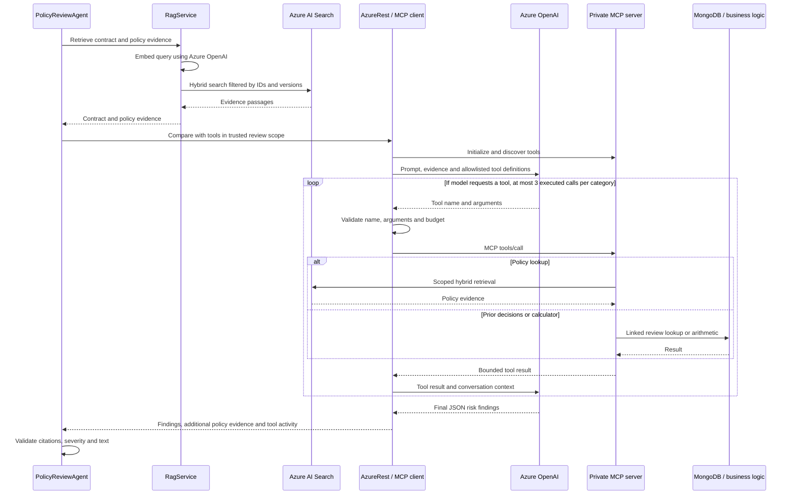
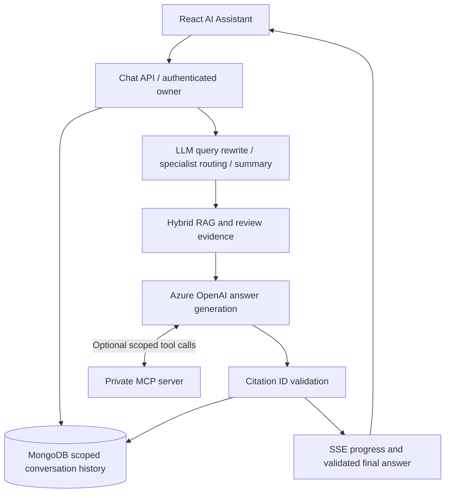

# TelecomIQ — Telecom Vendor Risk Intelligence

**Agentic AI reference application for telecom vendor agreement analysis, policy compliance, risk identification and human-driven decisions.**

TelecomIQ ingests fictional vendor agreements and versioned company policies, retrieves relevant contract and policy evidence using hybrid RAG, and generates actionable risk findings using Azure OpenAI. During policy comparisons, the model can dynamically select read-only business tools exposed through a private Model Context Protocol (MCP) server. A human reviewer evaluates the evidence and records decisions; the AI does not approve contracts.

Independent learning project, inspired by telecom operator workflows. Not affiliated with T-Mobile. Synthetic documents only; not production-ready.

[Hosted demo (authorized sign-in required)](https://telecomiq-demo-x6ub3bqyhbii6.azurewebsites.net/) · [Swagger API](https://telecomiq-demo-x6ub3bqyhbii6.azurewebsites.net/swagger/index.html) · [Deployment guide](deploy/hosted-demo.md) · [Development guide](docs/dev-connectivity.md)

## 1. System architecture



The hosted demo runs the API, React static assets and background worker in the existing App Service. Local development can run the API and worker as separate processes. MCP uses the same deployed executable in a private child-process mode; it is not a public HTTP endpoint.

## 2. Document ingestion flow



Both indexes use HNSW and 1,536-dimensional vectors; contract IDs and policy IDs/versions scope retrieval. Upload and ingestion failures require retry or reconciliation as appropriate.

## 3. Agentic AI risk review flow



For each specialist role, the agent retrieves evidence and calls Azure OpenAI. These roles execute sequentially through shared agent implementations, not as independent autonomous agents. Policy comparison requires evidence from both the agreement and selected policies. Findings with invalid evidence IDs or severities are filtered. Revision rechecks can return Resolved, StillPresent or NeedsReview.

## 4. RAG and MCP tool-calling sequence



The model may choose zero tools. Agreement-only reviews and individual revision rechecks use their existing non-tool paths. The private MCP child inherits host configuration and runs within the existing trust boundary.

| MCP tool | Purpose | Data source |
| --- | --- | --- |
| `get_policy_requirement` | Retrieve additional passages from the selected policy versions | Azure OpenAI embeddings + Azure AI Search |
| `get_review_decisions` | Read decisions from the linked previous completed review, if present | MongoDB Atlas |
| `calculate_liability` | Calculate annual contract value × months / 12 | Deterministic C# arithmetic |

The calculator does not independently verify the supplied financial values. Prior decisions do not automatically authorize a new contract. No tool can change policies, approve findings or access arbitrary review IDs.

## 5. Technology stack and project structure

| Layer | Technology / responsibility |
| --- | --- |
| Frontend | React, TypeScript, Vite |
| API | ASP.NET Core, .NET 10, Swagger |
| Application | Agents, orchestrator, ingestion, RAG, services and ports |
| Domain | Contracts, policy versions, reviews, findings and decisions |
| AI | Azure OpenAI chat and embeddings, Azure Document Intelligence |
| Retrieval | Azure AI Search — hybrid keyword/vector search, HNSW |
| Tool integration | Azure OpenAI function calling, C# MCP SDK, private stdio transport |
| Data | Azure Blob Storage and MongoDB Atlas |
| Messaging | Azure Service Bus, hosted background worker |
| Security | Microsoft Entra ID, reviewer allowlist, managed identity, scoped Azure RBAC |
| Observability | Application Insights, worker and throttling logs, completed-review tool activity |
| Delivery | GitHub Actions, Azure OIDC, Bicep, Azure App Service |

```text
src/
  TelecomIQ.Api/             HTTP endpoints, hosted UI and authentication
  TelecomIQ.Application/     Agents, orchestration, RAG, ingestion and services
  TelecomIQ.Domain/          Business entities and review models
  TelecomIQ.Infrastructure/ Azure integrations, repositories, MCP client/server
  TelecomIQ.Worker/          Standalone background worker (local development)
frontend/                    React UI
deploy/                      Bicep, search schemas and deployment scripts
tests/                       Review checks and MCP smoke test
samples/                     Fictional agreement and policy PDFs
docs/                        Development and handoff notes
.github/workflows/           CI and Azure deployment
```

## 6. Implemented capabilities and boundaries

| Capability | State |
| --- | --- |
| PDF ingestion, overlapping character chunking and embeddings | Implemented |
| Hybrid RAG, separate vector indexes and policy version filtering | Implemented |
| Three specialist roles and centralized orchestration | Implemented; sequential workflow |
| Policy comparison, revision recheck, citations and suggested wording | Implemented |
| LLM function calling and private MCP client/server | Implemented for policy comparisons |
| Tool discovery and calculator smoke test | Passed in hosted deployment workflow |
| Human-in-the-loop and decision history | Implemented |
| Guardrails | Basic: untrusted-evidence prompts, citation ID checks, input/output and tool limits |
| Observability | Basic: application logs, Application Insights and tool duration/status |
| Advanced autonomous agents, semantic reranking, AI quality evaluation | Future work |
| Token/cost tracing, dedicated content safety, enterprise RBAC and resilient outbox | Future work |

The [CI run](https://github.com/githubaccproject/agentic-ai-dotnet-azure/actions/runs/45778693567) and [hosted deployment run](https://github.com/githubaccproject/agentic-ai-dotnet-azure/actions/runs/45778693655) for commit `404b6d7` passed, including review checks, MCP discovery/calculator smoke test, App Service deployment and anonymous-access check. This does not establish successful authenticated end-to-end model tool selection, policy retrieval or prior-decision lookup in Azure; those need live functional testing.

## 7. Local setup and testing

Install .NET 10 SDK and Node.js. Provision or reuse the approved development resources. Configure both hosts using environment variables or local secret configuration (never commit credentials):

- `Azure__BlobContainer`, `Azure__PolicyBlobContainer`
- `Azure__ServiceBusNamespace`, `Azure__Queue`
- `Azure__OpenAI`, `Azure__ChatDeployment`, `Azure__EmbeddingDeployment`
- `Azure__Search`, `Azure__SearchIndex` (contracts), `Azure__PolicySearchIndex` (policies)
- `Azure__DocumentIntelligence`
- `Mongo__ConnectionString`, `Mongo__Database`

Create indexes from [contracts schema](deploy/search-index.json) and [policies schema](deploy/policies-index.json). Assign appropriate data-plane RBAC roles and run `az login` locally. See the [development connectivity guide](docs/dev-connectivity.md) for the detailed procedure.

```bash
dotnet build TelecomIQ.slnx -c Release
dotnet run --project tests/TelecomIQ.ReviewChecks -c Release --no-build
python3 tests/mcp-smoke.py
```

Run the API in local Development and the worker in a separate terminal. Start the React frontend following [frontend setup](frontend/README.md).

Use the [fictional agreement](samples/TelecomIQ_Fictional_Vendor_Agreement.pdf) and [seven sample policies](samples/TelecomIQ_Seven_Sample_Policies.zip) to test ingestion, select ready policies, compare, inspect Agent activity and record a decision. For the prior-decision tool, create a linked revision and re-review. Tool selection is model-dependent.

## 8. Limitations and responsible use

This is a learning and reference implementation, not legal advice or a production contract approval system. Only fictional documents are supported. Evidence ID checks do not prove semantic accuracy or exhaustive coverage. Reviewer names are currently entered manually; production should bind decisions to verified identities. Prompt-only injection defenses are not sufficient for production. There is no transactional outbox or guarantee of exactly-once execution, and advanced concurrency, quality evaluation, telemetry and security controls remain open. Reuse existing resources and obtain approval before provisioning billable services.

Existing API routes and data schemas are retained for compatibility. TelecomIQ is the business-facing and internal project name; existing Azure resources are not renamed automatically.

## 9. Conversational contract assistant

Load a Ready agreement, optionally complete a policy review, then use **04 · AI Assistant**. A chat is pinned to the agreement and completed review (if any) and owned by the signed-in demo reviewer. Chat-only retrieval uses the agreement; a completed review enables pinned policy retrieval, findings, recorded decisions and private MCP tools. The model rewrites follow-ups, classifies the question into a specialist domain, compresses history, retrieves evidence and selects tools when useful. The server rejects unknown citation IDs and returns an insufficient-evidence response instead. Citation ID validation is structural. A second model call checks whether the answer is supported by the cited evidence and relevant to the question, and rejects answers it cannot support. This is a model-based quality gate, not independent proof or legal verification.



The UI streams progress events, not raw unvalidated LLM tokens. It displays citations, tool activity, token usage, latency and optional estimated cost. Configure `Chat__InputUsdPerMillion`, `Chat__OutputUsdPerMillion` and `Chat__EmbeddingUsdPerMillion` using actual deployment rates; estimates are unavailable if prices or usage are missing. MCP child embedding tokens are not currently reported. Instrumentation emits structured logs and ActivitySource/Meter signals; exporting custom telemetry to a collector requires configuration. Conversation history is retained in MongoDB until explicitly deleted. The demo uses shared fictional agreements; production requires document-level access control, retention policy, PII/content-safety controls, independently benchmarked semantic evaluation and further load testing. No new Azure resources are required. CI covers structural guardrails and MongoDB serialization; live authenticated chat tests remain required.
